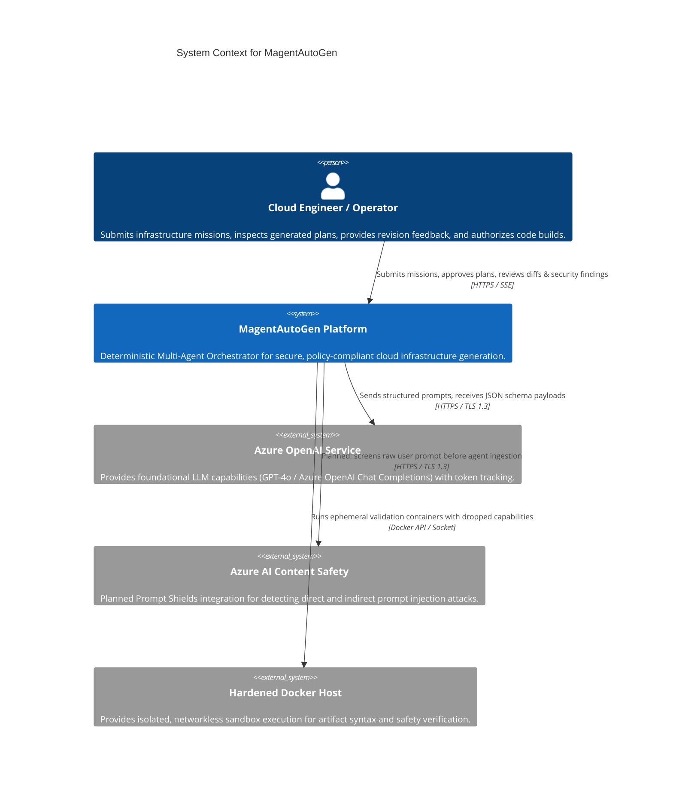
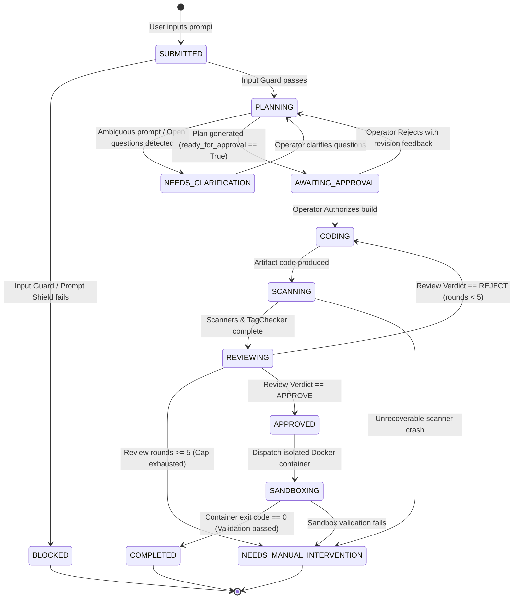
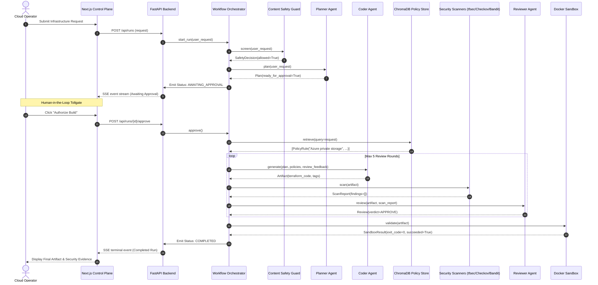

# 🏛️ MagentAutoGen — Master System Architecture & Component Specification

**Classification:** Proof-of-Concept Engineering Specification  
**Version:** 2.1.0 (FastAPI + Next.js implementation baseline)  
**Target Audience:** Principal Engineers, Security Architects, Cloud Operators, AI Practitioners  
**Core Technologies:** Python 3.11+, FastAPI, Next.js 14 (React / TypeScript), Microsoft Agent Framework / Azure OpenAI, ChromaDB, Docker, Bandit, Checkov, tfsec  

---

## 1. Executive Summary & Strategic Mission

**MagentAutoGen** is an Azure-native proof of concept for controlled cloud-infrastructure generation, security verification, and policy compliance with explicit **Human-in-the-Loop (HITL)** governance.

Unlike naive multi-agent architectures that rely on unconstrained conversational loops (such as unguided `GroupChat`), MagentAutoGen enforces a **typed, finite-state machine (FSM)**. Every cognitive task transitions through hardened tollgates:
1. **Input Shielding**: Pre-LLM screening against jailbreaks and prompt injections.
2. **Ambiguity Resolution & Plan Gate**: Explicit human approval before any artifact code generation.
3. **Dynamic Governance RAG**: Ingestion of versioned corporate rules into agent context using semantic vector retrieval.
4. **Static Security Analysis**: Multi-scanner analysis (`tfsec`, `Checkov`, `Bandit`) evaluating generated code before peer review.
5. **Bounded Peer Review**: Structured critique loop with a hard limit of 5 review iterations.
6. **Hardened Docker Sandbox**: Isolated validation with no network egress, read-only root filesystems, and strict CPU/memory limits (strictly zero host execution). The separate fixed Infracost price lookup has HTTPS egress only because current price data is remote; it never executes generated code or Terraform apply.
7. **FinOps & Full-Spectrum Observability**: Real-time token usage attribution, pricing estimation, and OpenTelemetry structured JSON logs with zero credential leakage.

---

## 2. High-Level System Context (C4 Level 1)



---

## 3. Container & Subsystem Architecture (C4 Level 2)

MagentAutoGen is decoupled into modular layers to ensure clear separation of concerns, independent container scaling, and robust fault isolation.

```mermaid
C4Container
    title Container Diagram for MagentAutoGen Subsystems

    Person(operator, "Operator", "Interacts via Web Browser")

    Container(frontend, "Control Plane Dashboard", "Next.js 14 / TypeScript / Tailwind", "Modern dark glassmorphic UI: interactive agent graph, code diffs, FinOps charts, approval gates, terminal stream.")
    
    Container_Boundary(backend_boundary, "Backend Core Engine") {
        Container(api, "FastAPI API Gateway", "FastAPI / Uvicorn", "Provides REST endpoints (/api/runs) and an SSE endpoint for workflow telemetry.")
        Container(orchestrator, "Workflow Orchestrator", "Python 3.11", "Deterministic FSM managing agent state transitions, checkpoints, and review iteration caps.")
        
        Container_Boundary(agent_mesh, "Agent Mesh") {
            Component(planner, "Planner Agent", "Python / Agent Framework", "Decomposes goals, identifies ambiguities, produces structured Plan models.")
            Component(coder, "Coder Agent", "Python / Agent Framework", "Consumes approved plans + RAG policies, injects mandatory cloud governance tags.")
            Component(reviewer, "Reviewer Agent", "Python / Agent Framework", "Evaluates static scan reports against code quality standards, issues APPROVE / REJECT verdicts.")
        }

        Container_Boundary(security_pipeline, "Security & Sandbox Pipeline") {
            Component(scanners, "Static Scanner Mesh", "tfsec / Checkov / Bandit", "Executes multi-language static analysis and normalizes findings into SecurityFinding models.")
            Component(tag_checker, "Tag Governance Engine", "Python AST / Regex", "Enforces environment, owner, and cost_center tags on all cloud resources.")
            Component(sandbox, "Docker Sandbox Runner", "Docker CLI / Worker", "Runs isolated validation inside networkless, read-only Linux containers.")
        }

        Container_Boundary(rag_engine, "Policy RAG Subsystem") {
            Component(vector_store, "ChromaDB Store", "ChromaDB / PersistentClient", "Persists local sentence-transformer embeddings with cosine distance indexing.")
            Component(ingestor, "Policy Ingestor CLI", "Python", "Chunks policy documents, computes SHA-256 content hashes, generates manifest records.")
        }

        ContainerDb(run_store, "File-Backed RunStore", "Local Disk / JSON", "Persists WorkflowRun states, audit logs, and conversation traces.")
    }

    Rel(operator, frontend, "Interacts with", "HTTPS")
    Rel(frontend, api, "Queries state & receives events", "HTTP REST / Server-Sent Events")
    Rel(api, orchestrator, "Dispatches workflow triggers", "Async Python Call")
    Rel(orchestrator, agent_mesh, "Coordinates LLM reasoning", "Typed Models")
    Rel(orchestrator, security_pipeline, "Triggers code validation", "Process Isolation")
    Rel(orchestrator, rag_engine, "Queries relevant policy rules", "Cosine Similarity Search")
    Rel(orchestrator, run_store, "Saves / Restores State", "Atomic File I/O")
```

---

## 4. Finite State Machine & Workflow Lifecycle (C4 Level 3)

The `WorkflowOrchestrator` governs the entire lifecycle through explicit, typed state transitions. No agent can run out of sequence.



### 4.1 State Machine Rules & Invariants
- **Inviolable Human Gate**: The state `CODING` can **never** be entered directly from `PLANNING`. It strictly requires a signed authorization event from `AWAITING_APPROVAL`.
- **Iteration Ceiling**: The review loop `CODING <-> REVIEWING` is strictly capped at `MAGENT_MAX_REVIEW_ROUNDS` (default: 5). If the Coder cannot satisfy the Reviewer in 5 iterations, the run transitions to `NEEDS_MANUAL_INTERVENTION` to eliminate runaway token spend.
- **Fail-Closed Gate**: If any scanner produces a `CRITICAL` or `HIGH` severity finding, the Reviewer must reject the code and provide actionable remediation guidance.

---

## 5. Detailed Component Deep-Dive

### 5.1 Cognitive Agent Mesh (`src/agents/`)

| Module | Core Class | Primary Responsibility & Design Details |
|---|---|---|
| [`planner_agent.py`](file:///c:/Users/21623/PycharmProjects/MagentsAutoGen/src/agents/planner_agent.py) | `PlannerAgent` | Ingests raw mission prompts. Formulates `Plan` models with steps, target technology (Terraform/Python), expected outputs, and risk assessments. Populates `open_questions` if prompt is underspecified. |
| [`coder_agent.py`](file:///c:/Users/21623/PycharmProjects/MagentsAutoGen/src/agents/coder_agent.py) | `CoderAgent` | Consumes approved plans, previous review feedback (if iterating), and dynamically retrieved corporate policies. Generates clean `Artifact` code with mandatory Azure tags (`environment`, `owner`, `cost_center`). |
| [`reviewer_agent.py`](file:///c:/Users/21623/PycharmProjects/MagentsAutoGen/src/agents/reviewer_agent.py) | `ReviewerAgent` | Cross-examines the `Artifact` code against the `ScanReport` (static scanner results) and corporate policies. Produces a typed `Review` object with findings, improvement notes, and an `APPROVE` or `REJECT` verdict. |
| [`model_provider.py`](file:///c:/Users/21623/PycharmProjects/MagentsAutoGen/src/agents/model_provider.py) | `AgentFrameworkProvider` | Interface to Azure OpenAI via Microsoft Agent Framework. Extracts exact prompt and completion token counts from response metadata and streams structured logs. |
| [`demo_provider.py`](file:///c:/Users/21623/PycharmProjects/MagentsAutoGen/src/agents/demo_provider.py) | `DemoProvider` | Offline, deterministic provider for local testing and CI/CD without active cloud credentials. Simulates realistic LLM responses, token metrics, and multi-round review flows. |
| [`parsing.py`](file:///c:/Users/21623/PycharmProjects/MagentsAutoGen/src/agents/parsing.py) | `extract_json_payload` | Resilient JSON extractor capable of parsing raw markdown code blocks (` ```json ... ``` `) and malformed LLM outputs. |

---

### 5.2 Security, Governance & Isolated Sandbox (`src/security/`)

| Module | Core Class | Primary Responsibility & Design Details |
|---|---|---|
| [`scanners.py`](file:///c:/Users/21623/PycharmProjects/MagentsAutoGen/src/security/scanners.py) | `SecurityScannerPipeline` | Orchestrates static analysis tools: <br>• **`tfsec`**: Terraform static analysis for cloud misconfigurations.<br>• **`Checkov`**: Policy-as-Code scanner for IaC compliance against CIS benchmarks.<br>• **`Bandit`**: AST-based vulnerability analysis for Python code (shell injections, weak crypto, unsafe deserialization).<br>Normalizes disparate outputs into a unified `SecurityFinding` list. |
| [`tag_checker.py`](file:///c:/Users/21623/PycharmProjects/MagentsAutoGen/src/security/tag_checker.py) | `TagChecker` | Evaluates Terraform AST / HCL blocks to guarantee mandatory tagging (`environment`, `owner`, `cost_center`). Flags missing tags as `CRITICAL` findings. |
| [`sandbox.py`](file:///c:/Users/21623/PycharmProjects/MagentsAutoGen/src/security/sandbox.py) | `DockerSandboxRunner` | Launches isolated Docker execution containers (`python:3.11-slim` or `hashicorp/terraform:1.9`) using secure container options: `--network none`, `--read-only`, `--cap-drop=ALL`, `--memory 512m`, `--cpus 1.0`. Guarantees **zero host execution** and **zero live cloud resource creation** (`terraform validate` only). |
| [`content_safety.py`](file:///c:/Users/21623/PycharmProjects/MagentsAutoGen/src/security/content_safety.py) | `LocalInputGuard` | Development-only guard that blocks known prompt-injection signatures, jailbreak markers, and oversized input. Azure Prompt Shields remain a required follow-up (MA-601/602). |

---

### 5.3 Semantic RAG & Dynamic Policy Retrieval (`src/rag/`)

| Module | Core Class | Primary Responsibility & Design Details |
|---|---|---|
| [`vector_store.py`](file:///c:/Users/21623/PycharmProjects/MagentsAutoGen/src/rag/vector_store.py) | `ChromaRuleStore` / `LocalRuleStore` | **ChromaRuleStore**: Local semantic retrieval backed by an on-disk ChromaDB collection (`magent_policies`) and sentence-transformer embeddings. <br>**LocalRuleStore**: Zero-dependency lexical fallback using keyword overlap scoring. Azure OpenAI embeddings remain MA-503. |
| [`ingestion.py`](file:///c:/Users/21623/PycharmProjects/MagentsAutoGen/src/rag/ingestion.py) | `ChromaPolicyIngestor` | Parses markdown rule documents (`data/internal_rules.txt`), computes SHA-256 hashes per section, chunks text, and generates immutable policy manifests. |
| [`ingest.py`](file:///c:/Users/21623/PycharmProjects/MagentsAutoGen/src/rag/ingest.py) | CLI Entrypoint | Command-line tool (`python -m src.rag.ingest`) for administrative re-indexing of corporate rules with full versioning. |

---

### 5.4 FinOps, Reliability & Observability (`src/utils/`, `config/`)

| Module | Core Class / File | Primary Responsibility & Design Details |
|---|---|---|
| [`cost_tracker.py`](file:///c:/Users/21623/PycharmProjects/MagentsAutoGen/src/utils/cost_tracker.py) | `CostTracker` | Captures token usage across every LLM interaction. Computes real-time input/output/embedding costs against [`config/pricing.json`](file:///c:/Users/21623/PycharmProjects/MagentsAutoGen/config/pricing.json). Produces detailed `SessionCostSummary` breakdown by agent and operation. |
| [`retry.py`](file:///c:/Users/21623/PycharmProjects/MagentsAutoGen/src/utils/retry.py) | `retry_async` / `ErrorEnvelope` | Handles transient Azure OpenAI errors (HTTP 429 rate limits, 503 service unavailable) using exponential backoff with jitter. Packages unexpected failures into structured `ErrorEnvelope` models. |
| [`redaction.py`](file:///c:/Users/21623/PycharmProjects/MagentsAutoGen/src/utils/redaction.py) | `redact_text` / `redact_data` | Deep recursive data sanitizer. Masks API keys, Azure Storage connection strings (`AccountKey=...`), JWTs, Bearer authorization tokens, and PKI private keys before writing to logs, traces, or UI feeds. |
| [`structured_logging.py`](file:///c:/Users/21623/PycharmProjects/MagentsAutoGen/src/utils/structured_logging.py) | `JsonFormatter` | Formats application logs into OpenTelemetry-compliant JSON containing `run_id`, `agent_name`, `timestamp`, `level`, and sanitized payloads. |
| [`context_manager.py`](file:///c:/Users/21623/PycharmProjects/MagentsAutoGen/src/utils/context_manager.py) | `ContextManager` | Monitors cumulative token usage during multi-round reviews. Summarizes previous conversations when approaching `MAGENT_MAX_CONTEXT_TOKENS` (default: 8,000) to avoid LLM context-window truncation. |

---

### 5.5 Presentation Layer & API Gateway (`src/api/`, `frontend/`)

| Module / Component | Technology | Primary Responsibility & Design Details |
|---|---|---|
| [`server.py`](file:///c:/Users/21623/PycharmProjects/MagentsAutoGen/src/api/server.py) | FastAPI / Uvicorn | REST API (`/api/runs`, `/api/runs/{id}`, `/api/runs/{id}/approve`, `/api/runs/{id}/reject`) plus `/api/runs/{id}/events/stream` for Server-Sent Event telemetry. |
| [`AgentGraph.tsx`](file:///c:/Users/21623/PycharmProjects/MagentsAutoGen/frontend/src/components/AgentGraph.tsx) | React Flow / TypeScript | Interactive node graph reflecting live agent state (Idle, Active, Awaiting Approval, Reviewing, Completed). |
| [`ApprovalPanel.tsx`](file:///c:/Users/21623/PycharmProjects/MagentsAutoGen/frontend/src/components/ApprovalPanel.tsx) | React / Tailwind | High-priority HITL authorization gate. Allows single-click approval or rejection with structured revision feedback. |
| [`CodeViewer.tsx`](file:///c:/Users/21623/PycharmProjects/MagentsAutoGen/frontend/src/components/CodeViewer.tsx) | React / Shiki | Syntax-highlighted code viewer displaying generated Terraform and Python artifacts with one-click copy and download. |
| [`ScanDashboard.tsx`](file:///c:/Users/21623/PycharmProjects/MagentsAutoGen/frontend/src/components/ScanDashboard.tsx) | React / Tailwind | Detailed security matrix displaying normalized findings from `tfsec`, `Checkov`, and `Bandit` with severity badges and rule IDs. |
| [`FinOpsCharts.tsx`](file:///c:/Users/21623/PycharmProjects/MagentsAutoGen/frontend/src/components/FinOpsCharts.tsx) | React / Recharts | Real-time token consumption breakdown and estimated Azure OpenAI costs per agent with mandatory disclaimer banners. |
| [`TerminalConsole.tsx`](file:///c:/Users/21623/PycharmProjects/MagentsAutoGen/frontend/src/components/TerminalConsole.tsx) | React / Lucide | SSE-backed terminal view rendering timestamped `WorkflowEvent` objects with level-coded color accents. |

---

## 6. End-to-End Execution Sequence Diagram



---

## 7. Security Architecture & Threat Model

| Threat Vector | Mitigation Strategy | Architectural Implementation |
|---|---|---|
| **Direct Prompt Injection** | Pre-LLM screening filter | `LocalInputGuard` blocks known patterns in local mode. Azure Prompt Shields integration is pending (MA-601/602). |
| **Corporate Policy Non-Compliance** | Dynamic RAG injection | ChromaDB vector search retrieves mandatory architecture policies before Coder execution. |
| **Missing Governance Metadata** | AST / HCL Tag Verification | `TagChecker` enforces mandatory tags (`environment`, `owner`, `cost_center`) as a hard blocker. |
| **Vulnerable Code Generation** | Multi-engine static analysis | `SecurityScannerPipeline` (`tfsec`, `Checkov`, `Bandit`) blocks `CRITICAL` and `HIGH` CVEs. |
| **Malicious Code Execution / RCE** | Non-execution policy & Sandbox | Strict validation-only policy (no `terraform apply`). Validation runs in ephemeral, read-only Docker containers with dropped Linux capabilities and no network. |
| **Credential / Key Leakage** | Deep Recursive Redaction | `redaction.py` masks Azure keys, passwords, connection strings, JWTs, and private keys across all logs, traces, and UI events. |
| **Unbounded Cloud Spend (FinOps Runaway)** | Hard review caps & Context Bounding | 5-round review ceiling (`MAGENT_MAX_REVIEW_ROUNDS`), explicit token caps, and `ContextManager` history pruning. |

---

## 8. Directory & Repository Map

```
MagentsAutoGen/
├── .github/
│   └── workflows/
│       └── ci.yml                 # Automated CI: unit tests, Ruff linting, Bandit scanning, Docker build
├── config/
│   └── pricing.json               # FinOps model pricing tables (GPT-4o, embeddings)
├── data/
│   ├── chroma/                    # ChromaDB vector store directory
│   ├── conversations/             # Raw conversation audit logs
│   ├── internal_rules.txt         # Corporate security and cloud governance rules
│   └── runs/                      # Serialized WorkflowRun JSON files
├── docker/
│   ├── Dockerfile.api             # Production multi-stage image for FastAPI backend
│   └── Dockerfile.sandbox         # Hardened, networkless sandbox worker image
├── docs/
│   ├── accessibility_and_security_review.md # WCAG 2.1 AA and Security review audit
│   ├── architecture.md            # Master Architecture & Component Specification (this document)
│   ├── AZURE_SETUP.md             # Azure OpenAI & Content Safety provisioning instructions
│   ├── DEMO_SCRIPT.md             # Step-by-step E2E demonstration script
│   ├── operator_guide.md          # Complete administrator and operator manual
│   └── triage.md                  # Project completion triage and backlog classification
├── frontend/                      # Next.js 14 Web Application
│   ├── Dockerfile                 # Multi-stage production image for Next.js frontend
│   └── src/
│       ├── app/                   # App Router pages and layout
│       └── components/            # UI components (AgentGraph, ApprovalPanel, CodeViewer, FinOpsCharts)
├── src/                           # Backend Core Python Source
│   ├── agents/                    # Planner, Coder, Reviewer, Model Provider implementations
│   ├── api/                       # FastAPI server and Server-Sent Events endpoint
│   ├── config/                    # Pydantic Settings and LLM configuration
│   ├── rag/                       # ChromaDB vector store and ingestion pipeline
│   ├── security/                  # Static scanners, tag checker, Docker sandbox, input guards
│   ├── utils/                     # CostTracker, redaction, retries, structured logging
│   └── workflow/                  # WorkflowOrchestrator, domain models, state persistence
├── tests/                         # Complete 108+ automated test suite
├── docker-compose.yml             # Frontend, API, sandbox, Postgres, auth-init
├── Makefile                       # Unified build, test, lint, and run targets
└── requirements.txt               # Pinned Python dependencies
```

---

## 9. Verification & Operational Health

The entire system is continuously validated through automated test pipelines:

```powershell
# Run the local automated test baseline (104 passing tests; Docker/Azure integration tests may skip)
.venv\Scripts\python -m pytest tests/ -v

# Run Ruff static linter
.venv\Scripts\ruff check src/ tests/

# Run the CI-aligned high-severity Bandit security scan
.venv\Scripts\bandit -r src/ -q -lll

# Launch full stack via Docker Compose
docker compose up --build
```

**Architectural Status:** Local proof-of-concept baseline verified. Azure Prompt Shields, Azure embeddings,
Azure Cost Management reconciliation, full container acceptance, and final end-to-end evidence are required
before release or enterprise deployment approval.
